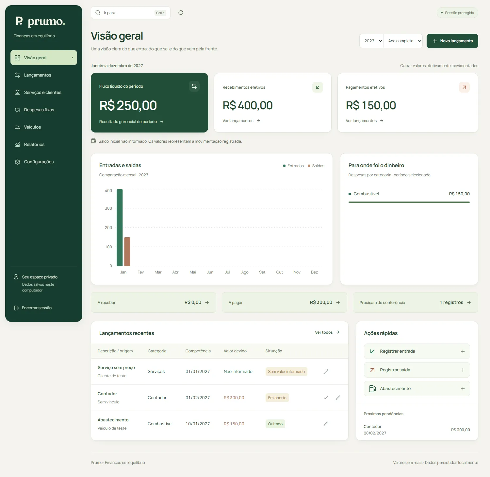

# Vercuno


**Landing pages, sites institucionais, sites catálogo e sistemas web.** O site da Vercuno apresenta os serviços, mostra o que foi entregue em cada projeto e abre uma conversa direta pelo WhatsApp.

[Projetos](#projetos) · [Desenvolvimento](#desenvolvimento) · [Configuração](#configuração) · [Onde editar](#onde-editar)

## Projetos

| Landing page | Site institucional | Sistema web |
| --- | --- | --- |
|  |  |  |

O catálogo em `/portfolio` reúne seis casos. Ao trocar de serviço, os cards entram e saem com transições curtas e se reposicionam na grade. A troca por teclado ou com movimento reduzido é imediata. O case da Náutica traz um comparador antes e depois com capturas reais em desktop e mobile.

| Projeto | Entrega | Página |
| --- | --- | --- |
| **Náutica Engenharia** | Landing page de serviços de engenharia com solicitação de orçamento pelo WhatsApp. | `/portfolio/nautica-engenharia` |
| **Caio Leonardi** | Site de psicologia clínica com informações sobre atendimento online e agendamento. | `/portfolio/caio-leonardi` |
| **Suzzy Alves Fotografia** | Site do estúdio com galeria de ensaios e agendamento pelo WhatsApp. | `/portfolio/suzzy-alves-fotografia` |
| **Marly Cestas e Flores** | Site catálogo de buquês, cestas e presentes com pedidos pelo WhatsApp. | `/portfolio/marly-cestas-e-flores` |
| **Zelo** | Painel de atendimento pelo WhatsApp com catálogo, assistente de IA e revisão de campanhas. | `/portfolio/zelo` |
| **Prumo** | Sistema financeiro para acompanhar recebimentos, pagamentos, serviços e despesas recorrentes. | `/portfolio/prumo` |

As capturas do Zelo e do Prumo usam dados fictícios. A procedência das imagens, fontes e demais ativos está registrada no repositório. [Origem dos ativos](public/assets/ASSET_SOURCES.md)

## Desenvolvimento

Use Node.js 22 LTS (22.12 ou superior) ou Node.js 24 LTS, com npm. No diretório do projeto, instale as dependências do lockfile e inicie o servidor.

```bash
npm ci
npm run dev
```

O catálogo, as páginas de serviço e a política de privacidade funcionam sem configuração do Supabase. [Abrir em localhost:3000](http://localhost:3000)

| Comando | O que faz |
| --- | --- |
| `npm run dev` | Inicia o servidor de desenvolvimento com recarga automática. |
| `npm run typecheck` | Verifica os tipos com TypeScript. |
| `npm test` | Executa os testes do schema de leads com Vitest. |
| `npm run build` | Gera o build de produção e pré-renderiza as páginas de serviços e cases. |
| `npm start` | Serve o build de produção localmente. |

O site usa **Next.js 16 com App Router**, **React 19** e **TypeScript**. A interface combina Tailwind CSS 4, CSS Modules e a fonte Rethink Sans hospedada no próprio projeto. O cadastro de serviços e cases alimenta as páginas, os metadados e o sitemap. O App Router também serve o `robots.txt` e as imagens de compartilhamento.

| Rota | O que você encontra |
| --- | --- |
| `/` | Serviços, projetos em destaque, equipe e contato. |
| `/servicos/<servico>` | Escopo, opções de contratação e projetos relacionados. Slugs `landing-pages`, `sites-institucionais`, `sites-catalogo` e `sistemas-web`. |
| `/portfolio` e `/portfolio/<projeto>` | Catálogo por serviço e detalhes de cada entrega. |
| `/privacidade` | Política de privacidade. |
| `POST /api/leads` | Validação e registro de leads no Supabase. |

## Configuração

Para personalizar o ambiente, copie [`.env.example`](.env.example) para `.env.local`. Na Vercel, configure essas variáveis no projeto. O arquivo [`vercel.json`](vercel.json) declara o framework Next.js.

| Variável | Quando usar |
| --- | --- |
| `NEXT_PUBLIC_SITE_URL` | Define o domínio canônico usado em metadados e sitemap. Em branco, usa o domínio de produção informado pela Vercel, quando disponível. Informe a URL ao publicar em outra plataforma. |
| `NEXT_PUBLIC_WHATSAPP_NUMBER` | Substitui o número comercial padrão. Use somente dígitos, com país e DDD. |
| `NEXT_PUBLIC_GOOGLE_BUSINESS_PROFILE_URL` | Adicione ao ambiente se quiser vincular o perfil do Google ao carrossel, quando houver avaliações cadastradas. |
| `SUPABASE_URL` | URL do projeto Supabase, necessária para persistir leads. |
| `SUPABASE_SECRET_KEY` | Chave secreta usada no servidor. `SUPABASE_SERVICE_ROLE_KEY` é aceita como alternativa para projetos antigos. |

### Contato e leads

O contato público abre o WhatsApp com uma mensagem sobre o serviço ou projeto. A rota `POST /api/leads` está disponível para uma integração de formulário. Ela valida os dados com Zod e grava em `public.leads` pelo servidor. Com um payload válido e sem credenciais, a rota responde com status `503`.

Para ativar a persistência, aplique as [migrações do Supabase](supabase/migrations) em ordem e configure a URL e a chave. As migrações ativam RLS e retiram o acesso à tabela dos papéis `anon` e `authenticated`. Mantenha a chave apenas no servidor, fora das variáveis `NEXT_PUBLIC_`.

### Deploy na VPS AWS

A VPS acompanha a branch `main` de [RafaelADSdev/Vercuno](https://github.com/RafaelADSdev/Vercuno). Para publicar um commit dessa branch, rode `git push origin main` com esse repositório configurado como `origin`.

O temporizador do systemd procura atualizações cerca de uma vez por minuto. O site continua no ar durante o build. A VPS roda os testes, valida o novo container e restaura a imagem anterior se a troca falhar.

Os arquivos do serviço estão em [`deploy/aws/`](deploy/aws). Na VPS, acompanhe as execuções com `sudo journalctl -u vercuno-deploy.service -f`.

## Onde editar

| Conteúdo | Arquivo |
| --- | --- |
| Serviços, textos, sócios e WhatsApp | [`src/data/site.ts`](src/data/site.ts) |
| Cases, categorias e capturas | [`src/lib/cases.ts`](src/lib/cases.ts) · [Guia para cadastrar um case](PORTFOLIO.md) |
| Avaliações | [`src/data/reviews.ts`](src/data/reviews.ts) |
| Filtros e transições do catálogo | [`src/components/CaseFilter.tsx`](src/components/CaseFilter.tsx) |
| Estilos globais e identidade visual | [`src/app/globals.css`](src/app/globals.css) · [Design da Vercuno](DESIGN.md) |
| Composição e metadados das páginas | [`src/app/`](src/app) |
| Validação e gravação de leads | [`src/lib/lead-schema.ts`](src/lib/lead-schema.ts) · [`src/app/api/leads/route.ts`](src/app/api/leads/route.ts) |

Antes de configurar o domínio público, confirme o WhatsApp comercial e atualize os dados do controlador na [política de privacidade](src/app/privacidade/page.tsx).
